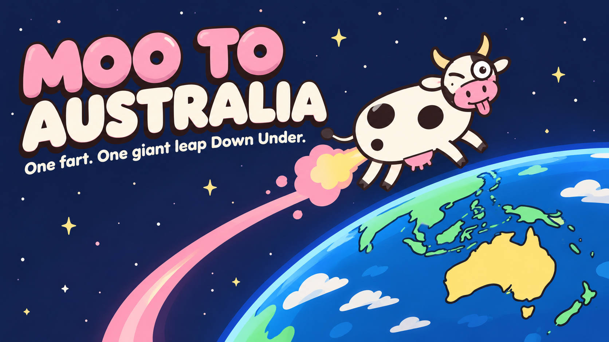

# MOO TO AUSTRALIA · 一屁抵澳

**One fart. One giant leap Down Under.**

A small browser game: pick a farm somewhere on Earth, aim the cow, set the fart power, and try to land anywhere on Australian soil. No aim line. You learn from your trails.

Sister game to *MOO TO THE MOON*.

▶ **Play:** https://aelisonx.github.io/moo-to-australia/ (desktop and mobile browsers)

## How to play

- **Direction**: compass heading (0° = north).
- **Angle**: degrees above the horizon.
- **Fart power**: launch speed in km/s, *relative to the ground*.
- Hit **FART!** and watch: the camera follows the cow off the farm, pulls back into a seat-back-GPS view of the globe, then drops in for the landing.
- Up to six previous trails per launch site stay on the globe in different colours, so you can compare attempts. In globe view, drag to spin and pinch/scroll to zoom.
- Any Australian land counts: the mainland, Tasmania, the islands, and the external territories (Christmas Island, Cocos (Keeling), Norfolk, Heard & McDonald, Lord Howe, Macquarie, Ashmore & Cartier, Coral Sea). Water does not. The Australian Antarctic claim is… technically… not counted.

### World Tour (5 levels)

| # | From | To | Celebration |
|---|------|----|-------------|
| 1 | Taiwan farm | Australia | milkshakes with the local herd |
| 2 | Mongolian steppe | New Zealand | cheese picnic |
| 3 | Australian farm | France | cheese & croissants (or a vineyard…) |
| 4 | French farm | Switzerland | fondue in front of the Alps |
| 5 | New Zealand farm | home to Taiwan | bubble tea |

Landing anywhere on the target country's land clears a level. France = mainland + Corsica; New Zealand = main islands; Australia includes its islands and external territories. Celebration scenery (farm, vineyard, traffic jam) is a random cartoon ending, not a claim about the real spot you hit. After a miss, the results card tells you how far long/short and left/right of the line to the target you landed.

### Classic

Any farm → Australia from Taipei (easiest), Cape Town, London, New York, or Bermuda (hardest).

## The physics (simplified, but honest)

The cow is fiction. The trajectory is not.

- Spherical Earth, gravity toward the centre falling off with distance squared.
- Earth keeps rotating during the flight. The cow already moves with the spinning ground before it farts, so "jump up and wait for Australia to turn underneath" does not work. Jump straight up from the equator and you land slightly **west**.
- One instantaneous fart, then free fall. **No air resistance** (stated in-game).
- A single fart from the ground can't put the cow into orbit: she either comes back down or escapes Earth (escaping counts as a loss).
- Integrated in an Earth-centred inertial frame (RK4, adaptive step). Earth's rotation enters exactly twice: the ground velocity at launch, and rotating the landing point back into Earth-fixed coordinates. Max altitude, flight time and landing point all come from the same integration.
- Playback is sped up. The HUD shows simulated flight time and real watching time separately.

Fiction: the super-fart, plus a cow that is heat-proof and crash-proof. Please don't try this with a real cow.

## Validation

`npm run validate` runs 66 checks plus a playability sweep. The current report is in `build/validation-report.txt` once you've run it. The checks cover:

- frame round-trips (ECI ↔ ECEF ↔ lat/lon)
- numerical integrator vs an independent closed-form Kepler solution: 500 random launches, landing points within 48 m, flight times within 1e-8 relative
- step-halving convergence
- vertical launch at the pole lands back on the pole; at the equator it drifts west
- escape threshold at √(2μ/R)
- no accidental satellites
- inside/outside Australia point tests (islands included)
- target-country tests for France (mainland vs overseas), Switzerland, Taiwan, New Zealand
- for every route (5 World Tour levels + 5 classic), a solution under 2 hours exists, and the numerical simulator confirms it

## Run it locally

```bash
npm install
npm run build      # bundles to docs/ (what GitHub Pages serves)
npm run serve      # http://localhost:8123
npm run validate   # physics + geography checks
```

## Project layout

```
src/physics.ts   ECI integrator, launch state, landing/apex refinement, escape classification
src/kepler.ts    closed-form two-body solution (validation + sweeps)
src/geo.ts       target-country land tests, country lookup, distance to nearest target land
src/cities.ts    World Tour levels and classic launch sites
src/index.html   page shell (copied to docs/ by the build)
src/audio.ts     music + sound effects, synthesised live with Web Audio (no audio files)
src/art.ts       cow + props as SVG
src/game.ts      three.js scene, camera choreography, trails, UI
src/data/        generated from Natural Earth by tools/build_geo.py and tools/build_targets.py
tests/           validation suite
docs/            built game (GitHub Pages)
```

## Credits

- Map data: [Natural Earth](https://www.naturalearthdata.com/), public domain.
- Rendering: [three.js](https://threejs.org/), MIT.
- Font: Fredoka (SIL Open Font License), loaded from Google Fonts.

See [THIRD_PARTY_NOTICES.md](THIRD_PARTY_NOTICES.md).

## License

Code is released under the MIT License. See [LICENSE](LICENSE).
